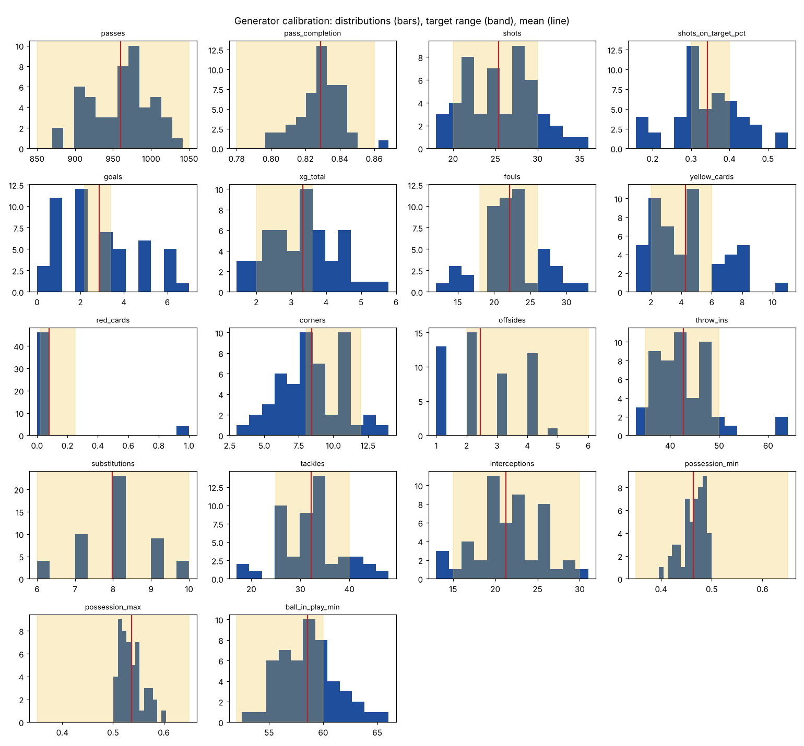

# Match data schema

Every match lives in `data/matches/{seed}/`. Generate one with
`cd backend && python -m app.generator --seed 2610 --out ../data/matches`.
The same seed always produces byte-identical files.

| File | Contents | Schema |
|---|---|---|
| `match.json` | Clubs, players, lineups, referee, venue, weather, kickoff | `schemas/match.schema.json` |
| `events.jsonl` | One event per line, in time order | `schemas/event.schema.json` |
| `tracking.npz` | 10 Hz positions of 22 players and the ball | below |
| `summary.json` | Match aggregates, the planted moments, and the validation measures | none |

## Pitch frame

Coordinates are metres on a fixed frame, x from 0 to 105 and y from 0 to 68. The home club
attacks x = 105 in the first half and x = 0 in the second; the renderer handles the switch.

## Event fields (spec 6.3)

| Field | Meaning |
|---|---|
| `event_id` | `e000123` |
| `seq` | Position in the log, increasing by 1 |
| `t` | Seconds since kickoff, stoppage included, half-time gap removed |
| `period` | 1 or 2 |
| `clock` | Display clock, `23:15` or `45+2:10` |
| `type` | One of the types below |
| `team_id`, `player_id` | Who did it, or null |
| `x`, `y` | Location in metres |
| `possession_id` | Increases by 1 at every `possession_change` |
| `under_pressure` | An opponent is close |
| `tags` | Mask and moment tags, e.g. `fouls`, `planted`, `moment:offside_through_ball`, `segment:2` |

## Event types and extra fields (spec 6.4)

| Type | Extra fields |
|---|---|
| `period_start`, `period_end` | `stoppage_added_s` (null at the start) |
| `kickoff` | none |
| `pass` | `receiver_id`, `end_x`, `end_y`, `length_m`, `height`, `pass_type`, `outcome`, `ball_speed_kmh`, `opponents_bypassed` |
| `carry` | `end_x`, `end_y`, `duration_s` |
| `shot` | `shot_type`, `body_part`, `outcome`, `ball_speed_kmh`, `goal_y`, `goal_z` |
| `goal` | `scorer_id`, `assist_id`, `shot_event_id`, `own_goal` |
| `save` | `keeper_id`, `shot_event_id` |
| `tackle` | `opponent_id`, `outcome` |
| `interception`, `clearance`, `block`, `offside`, `goal_kick`, `free_kick` | none |
| `pressure` | `target_id`, `duration_s`, `regained_within_5s` |
| `duel` | `duel_type`, `opponent_id`, `outcome` (from `player_id`'s side) |
| `foul` | `fouled_id`, `severity`, `advantage` |
| `advantage` | `foul_event_id` |
| `card` | `card`, `foul_event_id` |
| `throw_in`, `corner` | `side` |
| `out_of_play` | `last_touch_team_id`, `line` (`touch` or `end`: the line the ball crossed) |
| `substitution` | `player_off_id`, `player_on_id` |
| `possession_change` | `from_team_id`, `to_team_id`, `cause` |

## Planted moments (spec 6.7)

One per live-square segment, listed in `summary.json` under `planted` with its clock time.
Swap a scenario with `generate(seed, plants={segment: "name"})`.

| Segment | Scenario | Normal answer | Advanced answer |
|---|---|---|---|
| 5–20' | `advantage_then_shot` | Advantage | xG of the shot |
| 20–38' | `offside_through_ball` | Offside | Pass `length_m` |
| 38–60' | `long_range_tip_over` | Corner | Shot `ball_speed_kmh` |
| 60–75' | `thirteen_pass_block` | Corner | 13 passes in the possession |
| 75–88' | `switch_then_wide` | Goal kick | Switch `length_m` (about 45 m) |

## tracking.npz

| Array | Meaning |
|---|---|
| `positions` | int16, shape (frames, 23, 2), decimetres. Slots 0–10 home, 11–21 away, 22 the ball. A sent-off player's slot reads -1. |
| `slot_ids` | The 22 starting player ids. A substitution hands the slot to `player_on_id`. |
| `hz` | 10 |

The movement model (spec 6.6) runs after the events: the player on the ball moves with it, the
receiver runs onto each pass, players about to act run to where they act, the nearest opponents
chase the carrier, and everyone else drifts around a shifted formation spot with their own
noise, top speed and a 3.5 m/s² acceleration cap. Every event's `x`, `y` is then rewritten to
its player's tracked position, so events and tracking agree within 0.5 m.

## Validation

`python -m app.generator.validate --seeds 50 --chart ../docs/validation.png` checks the 50-seed
means against spec 6.8 and draws the distributions.

